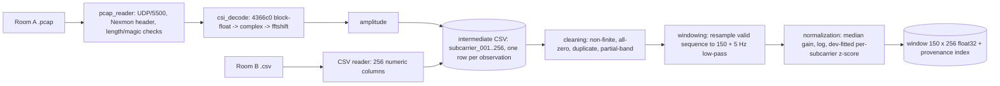

# Cross-Room Few-Shot Adaptation for WiFi CSI Activity Recognition

CS60055 Ubiquitous Computing — Hackathon Challenge 2 — Technical Report (draft)

Repository: https://github.com/ritabrata2004/Ubiquitous-Hackathon2

> Status: complete except the sections marked **[TEAM]** (contribution statement, AI-use
> disclosure check). All numbers are generated by the scripts and stored in `results/`.

---

## 1. Introduction

A WiFi sensing model trained in one indoor environment carries that environment's multipath
signature into its representation. We build a complete Python pipeline that (i) reconstructs a
common CSI amplitude representation from two very differently packaged recordings — raw Nexmon
PCAPs (Room A, Experiment 2) and amplitude CSVs (Room B, Experiment 3) — (ii) identifies which
recorded environment a window came from, (iii) learns a representation from unlabeled
recordings of both rooms, and (iv) recognizes activities in a target room using only K labeled
captures per target-exclusive activity, transferring SIT, STAND and WALK from the source room.

All results are **validation results** on the fixed challenge validation sets, not unseen-test
accuracy.

## 2. Data and Inspection

| | Room A (Experiment 2) | Room B (Experiment 3) |
|---|---|---|
| Format | raw `.pcap`, Nexmon UDP/5500 | amplitude `.csv`, 256 integer columns |
| Captures (dev + val) | 934 + 150 (supplied `validation/`) | 1,076 + 125 (created, seed 42) |
| Activities | fall, sit, sitdown, stand, standup, walk | empty, lying, sit, stand, walk |
| Observations / capture | 112–251 packets (median 221), ≈ 3.9 s | exactly 500 rows |
| Timestamps | yes (PCAP record time) | none |

Findings from `scripts/inspect_data.py` (`results/inspection.json`):

* **Packet structure.** All CSI datagrams are UDP/5500 with an 18-byte Nexmon header (magic
  `0x1111`, RSSI, frame control, source MAC, sequence number, core/stream, chanspec, chip
  version) followed by 256 × 4-byte CSI words. One chanspec (`0xe02a`, 80 MHz) and one chip
  version (`0x6a`); all packets are core 0 / stream 0. Two packets (of 234,021) are truncated
  (726 bytes) and rejected.
* **20 MHz frames inside the 80 MHz layout.** For ~71% of Room-A observations, only the primary
  20 MHz sub-band (64 subcarriers) carries energy; the remaining 192 subcarriers sit at the
  noise floor (exponent ≈ −16). These are frames transmitted at 20 MHz and reported in the
  80 MHz layout. The minimum sub-band energy share is sharply bimodal
  (Fig. `subband_energy_share.png`), so frame bandwidth — not the sequence-number field — is
  the right validity criterion. Room B shows the same phenomenon for ~6% of rows.
* **Consequence.** A Room-A capture holds a median of **59 full-band observations**
  (5th–95th percentile 31–111); **no** capture reaches 150. Room B holds a median of 499.
* **Ordering.** Room B is already in frequency order (DC null at the centre). Two Room-A
  captures show small timestamp reversals (< 70 ms); we keep PCAP record order.
* **Schema variants.** Five Room-B files use header `0..255` instead of `Subcarrier_1..256`;
  four files lack `_Amp_` in the name. Neither affects content.

## 3. Preprocessing Pipeline

Each stage is a small module in `src/`; `scripts/build_dataset.py` runs the whole chain and
`run_episode.py` calls the same per-capture functions (`src/pipeline.py`). A test checks that
both paths produce identical windows.

### 3.1 CSI decoding (Room A)

The BCM4366c0 reports each subcarrier as one 32-bit block-floating-point word: sign and 11-bit
magnitude for the real part (bits 29, 28–18), the same for the imaginary part (bits 17, 16–6)
and a shared 6-bit two's-complement exponent (bits 5–0); H = (±re + j·±im)·2^exp. We keep the
exponent exactly rather than rescaling per packet, so amplitudes share one scale within a
capture. Words arrive in FFT order; `fftshift` gives frequency order, matching Room B. A
round-trip unit test packs random values into the documented layout and checks the decoder.
Sanity: decoded spectra are smooth (adjacent-subcarrier log-amplitude correlation 0.996) with
a DC null at index 128 and guard bands at the edges.

### 3.2 Common intermediate form

One CSV per capture with 256 amplitude columns `subcarrier_001…256` and one row per decoded
observation in temporal order (`src/intermediate.py`). From here on, the pipeline does not know
whether the source was PCAP or CSV.

### 3.3 Quality control

`src/cleaning.py` rejects, per observation and in this order: non-finite values, all-zero rows,
exact duplicates within a capture, and **partial-band** rows whose smallest 20 MHz sub-band
holds < 0.5% of the CSI energy. The threshold sits in the empty valley between the two modes of
the sub-band-share distribution, so the outcome is insensitive to its exact value. Captures with
fewer than 10 valid observations cannot form a window and are excluded:

| | dev captures | dev excluded | val captures | val excluded |
|---|---|---|---|---|
| Room A | 934 | 7 (sit ×3, stand ×4) | 150 | 2 (`sit201`, `stand137`) |
| Room B | 1,076 | 0 | 125 | 0 |

No non-finite, all-zero or duplicate observations were found; all rejections are partial-band
(`results/qc_report.json`). We did not apply wavelet or other denoising: the low-pass in §3.4
already removes high-frequency fluctuation, and nothing in the task requires more.

### 3.4 Windowing

The official input is a (150, 256) window. Because no Room-A capture has 150 valid
observations, we form **one window per capture** by resampling the capture's whole valid
sequence to 150 steps with a polyphase FIR filter (`scipy.signal.resample_poly`, anti-aliased
when downsampling). The same rule is applied to both rooms (Room A ≈ 59 → 150, Room B ≈ 480 →
150). Alternatives we rejected:

* *Edge-padding Room A to 150* — every Room-A window would end in a constant tail, a trivial
  room cue.
* *Keeping the 20 MHz frames* — rows would alternate between full-band and ¾-empty spectra.

**Bandwidth equalization.** Resampling leaves Room-A windows with no content above
≈ n_valid/2 cycles per window, while Room-B windows are full-band. A room classifier using
*only* the subcarrier-averaged temporal power spectrum reached 100% on the shared
SIT/STAND/WALK classes, and within Room A the high-frequency share correlated with packet count
(r = 0.84) — an indirect packet-count shortcut that the challenge forbids. A common zero-phase
4th-order Butterworth low-pass at 20 cycles per window (≈ 5 Hz for a 4 s capture, above the
dominant frequencies of these activities) reduces the dynamics-only room accuracy on shared
classes to 75.7% and the packet-count correlation to 0.18; stronger filtering does not reduce
it further, indicating the residual reflects genuine session differences. Windows never mix
captures and the procedure is deterministic.

### 3.5 Normalization

`src/normalization.py`, applied to every window:

1. divide by the window's median amplitude — the rooms report amplitude on unrelated scales
   (decoded block-float vs integer export) and per-session gain is not activity information;
2. `log(x + 1e-3)` — compresses multipath dynamic range;
3. per-subcarrier z-score with mean/std fitted on **development windows only**.

Steps 1–2 have no fitted parameters. Validation windows are transformed with the
development statistics.

### 3.6 Splits and provenance

* Room A: the supplied `validation/` folder is the validation set; never moved to development.
* Room B: per class, filenames sorted lexicographically, 25 drawn with
  `numpy.random.default_rng(42)` (one generator, classes in sorted order); frozen in
  `splits/room_B_validation.txt`.
* The capture is the atomic unit; one capture = one window, so no capture can straddle splits
  (tested).
* `windows/index.csv` maps each `window_XXXX.npy` to split, room, label, capture id, source
  path, source SHA-1, number of valid observations and the hash of the preprocessing config.
  Window ids are a seeded permutation and carry no room/label/split information.

## 4. Leakage Controls

| Rule | How it is enforced |
|---|---|
| Capture-level isolation | one window per capture; test asserts no capture in both splits |
| Validation only for evaluation | all fitted statistics (normalization, per-room feature stats), SSL pretraining, probes and heads use development windows only |
| Target-label isolation (Task 3) | support drawn from target **development** captures of target-exclusive classes only; target SIT/STAND/WALK labels never used |
| No metadata shortcuts | models see only the (150, 256) array; labels/rooms come from the index as targets only; bandwidth shortcut removed (§3.4) |
| No query matching | neutral window ids; no lookup against known captures |
| No source-author code | own decoder from the documented bit layout; the MATLAB folder and LSTM notebook were not extracted |

## 5. Task 1 — Recorded-Environment Identification

**Models** (`scripts/task1_room.py`), trained on development windows of both rooms:

* `static_profile` — logistic regression on the per-subcarrier temporal mean (multipath profile);
* `dynamics_only` — logistic regression on the subcarrier-averaged temporal power spectrum
  (control with no spectral information);
* `handcrafted` — per-subcarrier mean and std plus motion energy (513 features);
* `cnn` — the shared encoder (§6) with a linear head, trained with random-length crops so that
  one model serves all window lengths; 3 seeds. Saved and reused for routing in Task 3.

**Window-length study:** validation windows are centre-cropped to L ∈ {10, 25, 50, 75, 100,
150}; logistic models are refit on equally cropped development windows.

**Results** (validation room accuracy, 273 windows; CNN = mean of 3 seeds, std 0 at all L):

| model | L=10 | L=25 | L=50 | L=75 | L=100 | **L=150** |
|---|---|---|---|---|---|---|
| static_profile | 1.000 | 1.000 | 1.000 | 1.000 | 1.000 | **1.000** |
| handcrafted | 1.000 | 1.000 | 1.000 | 1.000 | 1.000 | **1.000** |
| cnn | 1.000 | 1.000 | 1.000 | 1.000 | 1.000 | **1.000** |
| dynamics_only (control) | 0.575 | 0.700 | 0.725 | 0.751 | 0.755 | 0.857 |

(Fig. `room_acc_vs_window_length.png`.) The recorded environment is identified perfectly
from as few as 10 window steps, and the time-averaged multipath profile alone suffices: room
identity is a *static* property of the channel. The dynamics-only control, which has no access
to the spectral profile, degrades with window length as expected after bandwidth equalization;
before equalization it reached 0.989 at every length. Perfect accuracy should be read with
limitation 1 (§9) in mind: the two rooms are also two recording sessions.

## 6. Task 2 — Learning Without Labels

**Encoder** (`src/models.py`): 1-D CNN over time with the 256 subcarriers as input channels —
four Conv1d(k=5)+BatchNorm+GELU blocks (64, 64, 128, 128 channels; two stride-2), global
average pooling over time → 128-d embedding. Global pooling makes it length-agnostic.

**Pretraining** (`src/ssl.py`): SimCLR (NT-Xent, τ = 0.2) on development windows of both rooms
with no activity or room labels; 60 epochs, batch 128, AdamW, cosine schedule. Augmentations
model nuisances that should not change the activity: random temporal crop (75–150), per-
subcarrier log-normal gain jitter (σ = 0.2), random subcarrier block masking (8–48), time
masking (≤ 20%), Gaussian noise (σ = 0.1).

**Evaluation:** frozen embeddings → standardization + logistic regression fitted on labeled
development windows, scored on validation; compared with the same architecture with random
weights and with the handcrafted features. Probe settings: joint (8 activities across both
rooms), Room A only (6), Room B only (5). Metrics: macro-F1, balanced accuracy.

**Results** (frozen linear probe, validation; `results/task2_ssl.csv`):

| representation | joint (8) macro-F1 | joint bal. acc. | Room A (6) macro-F1 | Room B (5) macro-F1 |
|---|---|---|---|---|
| **SSL encoder** | **0.943** | **0.942** | 0.925 | **0.984** |
| random weights | 0.911 | 0.917 | **0.932** | 0.928 |
| handcrafted | 0.911 | 0.907 | 0.886 | **0.984** |

SSL pretraining improves the joint probe by 3.2 points over both baselines and Room B by 5.6
points over random weights; on Room A a randomly initialized convolutional encoder is already
as good (within 1 point). A random CNN with 256 input channels and global pooling is a strong
feature extractor for these windows, so the margin attributable to pretraining is modest.
UMAP (Fig. `task2_embeddings_ssl.png`) shows the representation is organized **first by room**
and only then by activity: without labels, the static channel signature is the dominant
source of variance shared by the two views of a window. This is the gap Task 3 must bridge.

## 7. Task 3 — Cross-Room Few-Label Adaptation

### 7.1 Setup

For target T with source S, T's head is trained on S's development SIT/STAND/WALK windows plus
K distinct T development captures per T-exclusive class (A: SITDOWN, STANDUP, FALL;
B: EMPTY, LYING), and evaluated on **all** T validation windows over T's class space
(148 windows for A, 125 for B). Support is redrawn for 10 episodes per K ∈ {1, 5, 10, 20}; we
report mean ± std over episodes. T's SIT/STAND/WALK labels and all validation data are never
used for fitting.

* **Representation.** Frozen SSL embedding (128-d, Task 2) plus 11 **event features**
  (`src/features.py`): the per-capture-normalized motion-energy profile (peak ratio, peak
  position, spread, kurtosis, 7-segment time profile). They describe *transition vs steady
  state* — FALL, SITDOWN, STANDUP are a burst followed by stillness; SIT, STAND, WALK are steady
  — and carry less room information than the embedding (development-set room predictability
  0.90 vs 0.999).
* **Domain alignment.** Embedding dimensions are standardized with each room's *unlabeled*
  development statistics (per-domain feature normalization); event features use pooled
  development statistics.
* **Heads.** `proto`: nearest class prototype by cosine similarity (Snell et al., 2017);
  `proto_tkm`: prototypes refined by 10 iterations of spherical k-means over the target room's
  unlabeled development windows, support kept anchored; `logreg`: class-balanced logistic
  regression; **`logreg_gp`**: `logreg` plus a **group-level prior correction** — one weight for
  the shared classes and one for the exclusive classes, set so that the predicted shared share
  on the target room's *unlabeled* development windows equals the uniform-class expectation
  |shared| / C (0.5 for A, 0.6 for B); ratios within each group are unchanged.
* **Routing.** In deployment the room is unknown: the Task-1 CNN predicts it, and the window is
  standardized with that room's statistics and classified by that room's head.

**Primary configuration and how it was chosen.** `ssl_event / logreg_gp`, routed. We first
selected `ssl / logreg` as the best of 9 representation/head pairs on validation (§7.3), then
diagnosed its failure modes and tested targeted fixes on the same validation episodes (§7.6);
the group prior was designed after seeing the first prior-correction results. Both steps are
selection on validation; the numbers below are validation results and likely somewhat
optimistic.

### 7.2 Results

**B → A (target A; exclusive: SITDOWN, STANDUP, FALL)**

| metric | K=1 | K=5 | K=10 | K=20 |
|---|---|---|---|---|
| **macro-F1 (all target classes)** | 0.280 ± 0.04 | 0.399 ± 0.03 | 0.431 ± 0.04 | 0.477 ± 0.02 |
| target-exclusive macro-F1 | 0.393 ± 0.07 | 0.600 ± 0.04 | 0.668 ± 0.07 | 0.741 ± 0.02 |
| shared SIT/STAND/WALK macro-F1 | 0.166 ± 0.03 | 0.197 ± 0.03 | 0.193 ± 0.02 | 0.213 ± 0.02 |
| balanced accuracy | 0.288 ± 0.04 | 0.405 ± 0.03 | 0.435 ± 0.04 | 0.479 ± 0.02 |

**A → B (target B; exclusive: EMPTY, LYING)**

| metric | K=1 | K=5 | K=10 | K=20 |
|---|---|---|---|---|
| **macro-F1 (all target classes)** | 0.344 ± 0.06 | 0.486 ± 0.05 | 0.562 ± 0.03 | 0.617 ± 0.02 |
| target-exclusive macro-F1 | 0.385 ± 0.07 | 0.631 ± 0.08 | 0.783 ± 0.05 | 0.851 ± 0.03 |
| shared SIT/STAND/WALK macro-F1 | 0.316 ± 0.06 | 0.389 ± 0.04 | 0.415 ± 0.04 | 0.461 ± 0.03 |
| balanced accuracy | 0.346 ± 0.06 | 0.498 ± 0.05 | 0.570 ± 0.04 | 0.626 ± 0.02 |

The ± values reflect support sampling only. With ~25 validation windows per class, test-set
noise on a single macro-F1 is about ±0.08; differences *between* configurations are assessed
with a paired bootstrap over validation windows (§7.6).

**Label efficiency** (Fig. `task3_label_efficiency.png`). Target-exclusive activities are
learned efficiently: macro-F1 rises from 0.39 → 0.74 (A) and 0.39 → 0.85 (B) as K goes from
1 to 20, most of it by K = 5–10. Transferred shared activities remain the bottleneck: they
improve slowly in A → B (0.32 → 0.46) and stay at 0.17–0.21 in B → A. With one shot every
configuration is close to chance (0.17 for 6 classes, 0.20 for 5).

### 7.3 Representation and head

Oracle routing, macro-F1, mean of 10 episodes:

| representation / head | B→A K=5 | B→A K=20 | A→B K=5 | A→B K=20 |
|---|---|---|---|---|
| ssl / proto | 0.359 | 0.369 | 0.347 | 0.429 |
| ssl / proto_tkm | 0.313 | 0.301 | 0.394 | 0.464 |
| ssl / logreg (previous primary) | 0.398 | 0.392 | 0.462 | 0.616 |
| ssl / logreg_gp | 0.410 | 0.457 | 0.465 | 0.605 |
| ssl_event / logreg | 0.398 | 0.425 | 0.488 | 0.605 |
| **ssl_event / logreg_gp (primary)** | 0.399 | **0.477** | 0.486 | **0.617** |
| random / proto | 0.303 | 0.273 | 0.387 | 0.463 |
| random / proto_tkm | 0.316 | 0.321 | 0.406 | 0.464 |
| random / logreg | 0.360 | 0.371 | 0.442 | 0.483 |
| handcrafted / proto | 0.392 | 0.383 | 0.415 | 0.468 |
| handcrafted / proto_tkm | 0.438 | 0.455 | 0.375 | 0.544 |
| handcrafted / logreg | 0.394 | 0.408 | 0.455 | 0.541 |

With the `logreg` head, self-supervised pretraining contributes +0.02 to +0.04 (B→A) and
+0.02 to +0.13 (A→B) macro-F1 over the same architecture with random weights. The group prior
mainly helps B → A at larger K; the event features help both directions slightly; together
they give the best mean over both directions and all K (0.450 vs 0.419 for the previous
primary). `handcrafted / proto_tkm` is competitive in B → A but not in A → B; we report it as
an observation and do not pick per direction.

### 7.4 Routing contribution

Fig. `task3_routing.png`; primary configuration; macro-F1 (shared-class macro-F1):

| condition | B→A K=5 | B→A K=20 | A→B K=5 | A→B K=20 |
|---|---|---|---|---|
| oracle room | 0.399 (0.20) | 0.477 (0.21) | 0.486 (0.39) | 0.617 (0.46) |
| **predicted room (routed)** | 0.399 (0.20) | 0.477 (0.21) | 0.486 (0.39) | 0.617 (0.46) |
| no routing | 0.410 (0.25) | 0.443 (0.22) | 0.369 (0.22) | 0.467 (0.24) |
| no per-room alignment | 0.400 (0.24) | 0.433 (0.23) | 0.419 (0.29) | 0.498 (0.31) |

The Task-1 room classifier is 100% accurate on validation, so predicted-room routing equals
oracle routing. Routing contributes clearly in A → B (+0.12 to +0.15 macro-F1 over no
routing), mostly through per-room alignment of the shared classes. In B → A its contribution is
small (−0.01 at K = 5, +0.03 at K = 20): once the group prior removes the shortcut (§7.6), the
per-room alignment that routing provides matters less there. For the previous primary
(`ssl / logreg`), routing added +0.04 to +0.07 (B→A) and +0.10 to +0.32 (A→B).

### 7.5 Per-class results at K = 5

Episode 0, routed (`task3_per_class_K5.csv`, Fig. `task3_confusion_K5.png`):

| target | activity | precision | recall | F1 |
|---|---|---|---|---|
| A | sit | 0.100 | 0.042 | 0.059 |
| A | stand | 0.180 | 0.375 | 0.243 |
| A | walk | 0.500 | 0.200 | 0.286 |
| A | fall | 0.553 | 0.840 | 0.667 |
| A | sitdown | 0.750 | 0.600 | 0.667 |
| A | standup | 0.600 | 0.480 | 0.533 |
| B | sit | 0.318 | 0.560 | 0.406 |
| B | stand | 0.000 | 0.000 | 0.000 |
| B | walk | 0.552 | 0.640 | 0.593 |
| B | empty | 0.524 | 0.440 | 0.478 |
| B | lying | 0.545 | 0.480 | 0.511 |

### 7.6 Failure analysis and targeted fixes

**Diagnosis of the previous primary (`ssl / logreg`).** Pooling its shared-class errors over
the 10 episodes (no new model selection) shows that the two directions fail differently:

| | B→A K=5 | B→A K=20 | A→B K=5 | A→B K=20 |
|---|---|---|---|---|
| shared-class errors predicted as a target-**exclusive** class | 61% | **87%** | 12% | 17% |
| shared-class errors that are **SIT ↔ STAND** | 19% | 7% | **63%** | **55%** |
| recall SIT / STAND / WALK | 0.02 / 0.38 / 0.16 | 0.00 / 0.19 / 0.04 | 0.45 / 0.11 / 0.67 | 0.71 / 0.11 / 0.63 |

* **Target A — exclusive classes absorb the shared ones** (a room shortcut). True SIT is
  predicted SITDOWN (55%) and true WALK is predicted SITDOWN (66%) at K = 20; it worsens as K
  grows.
* **Target B — STAND collapses into SIT.** True STAND is predicted SIT 60% of the time, while
  SIT itself reaches 0.71 recall at K = 20; WALK transfers (0.63).

**Mechanism: label shift in the per-room alignment.** After per-room standardization the room
is no longer linearly predictable from all development windows (5-fold accuracy 0.36), but it
*is* predictable from the shared-class windows alone (0.984; the room-predictive subspace has
about 14 directions, which can only be found with both rooms' shared labels). Each room's mean
is taken over a different activity mix (falls and transitions in A, empty and lying in B), so
subtracting it shifts the shared classes to different places in the two rooms. In the head,
all shared-class training windows come from the source room and all exclusive ones from the
target room, so the residual offset is learned as evidence for the exclusive classes. Within a
room the shared classes are easy (Task-2 per-room probes 0.93–0.98), and a model that sees only
the static multipath profile transfers SIT/STAND/WALK at or below chance (shared F1 0.06–0.31
in a 5-episode check): static postures are encoded mainly as a room-specific change of the
multipath pattern (cf. limitation 2), which no label-free alignment can undo.

**Fixes evaluated** (`scripts/task3_improvements.py`, `results/task3_improvements.csv`; same 10
episodes; macro-F1, plus the shortcut rate in A and the SIT↔STAND rate in B at K = 20):

| variant | B→A K=5 | B→A K=20 | A→B K=5 | A→B K=20 | A shortcut | B SIT↔STAND |
|---|---|---|---|---|---|---|
| previous primary (ssl / logreg) | 0.397 | 0.392 | 0.462 | 0.616 | 0.80 | 0.43 |
| *Round 1 (chosen before running)* | | | | | | |
| + 4 crops per support capture | 0.395 | 0.395 | 0.459 | 0.616 | 0.80 | 0.42 |
| + INLP on room (Ravfogel et al., 2020) | 0.397 | 0.392 | 0.462 | 0.616 | 0.80 | 0.43 |
| + INLP on head groups (source vs support) | 0.397 | 0.392 | 0.438 | 0.508 | 0.83 | 0.60 |
| + self-training (p ≥ 0.9, 3 rounds) | 0.367 | 0.367 | 0.452 | 0.600 | 0.87 | 0.52 |
| *Round 2 (prior correction, event features)* | | | | | | |
| + EM prior re-estimation (Saerens et al., 2002) | 0.357 | 0.344 | 0.485 | 0.593 | 0.94 | 0.37 |
| + per-class balanced prior | 0.427 | 0.485 | 0.413 | 0.517 | 0.27 | 0.71 |
| + group prior | 0.410 | 0.457 | 0.465 | 0.605 | 0.26 | 0.43 |
| + event features | 0.398 | 0.425 | 0.488 | 0.605 | 0.70 | 0.42 |
| + event features + balanced prior | 0.420 | 0.504 | 0.426 | 0.547 | 0.21 | 0.69 |
| **+ event features + group prior (primary)** | 0.399 | 0.477 | 0.486 | 0.617 | **0.20** | 0.44 |

* Support crops embed almost identically under global temporal pooling; INLP on room removes 0
  directions (room is not linearly predictable after alignment); INLP on head groups removes
  activity information because the groups coincide with shared vs exclusive classes;
  self-training confirms the model's own errors.
* **EM re-estimation reinforces the shortcut** (0.80 → 0.94): it assumes an unbiased
  classifier, which is exactly what fails here.
* **A per-class balanced prior fixes target A but harms target B** (−0.10 at K = 20): forcing
  STAND to its share pushes true SIT windows into STAND (SIT↔STAND 0.43 → 0.71).
* **The group prior targets only the diagnosed group-level shortcut.** It cuts the shortcut in
  A from 0.80 to 0.20–0.26 and leaves the within-shared split, and target B, essentially
  unchanged. The event-feature + balanced-prior variant scores higher on A but lower on B and on
  the mean over both directions, so it was not chosen.

**Paired bootstrap** (500 resamples of the validation windows, episodes averaged;
`results/task3_bootstrap.csv`), primary vs previous primary, macro-F1 difference [95% CI]:

| | K=1 | K=5 | K=10 | K=20 |
|---|---|---|---|---|
| B → A | +0.027 [+0.008, +0.049] | +0.001 [−0.019, +0.022] | +0.038 [+0.003, +0.071] | **+0.085 [+0.041, +0.123]** |
| A → B | +0.047 [−0.008, +0.097] | +0.024 [−0.008, +0.058] | +0.020 [−0.013, +0.057] | +0.001 [−0.034, +0.042] |

The improvement in B → A at K = 10–20 is clearly outside test-set noise; in A → B the change is
within noise and never significantly negative. The bootstrap does not account for the
selection among variants, so the true gain is probably somewhat smaller.

**What remains unsolved.** The SIT↔STAND confusion (about 0.44 in A → B) is unaffected by any
label-free method we tried and is the central finding of Task 3: posture is carried by the
same static channel component as the room fingerprint. Label-shift-aware alignment of the
encoder or a source-supervised, domain-adversarial encoder (Ganin et al., 2016) are natural
next steps; dynamic activities (WALK, FALL, transitions) remain the most transferable.

## 8. End-to-End System

`run_episode.py EPISODE_DIR` ingests raw `.pcap`/`.csv` captures, applies the identical
preprocessing, routes each window by predicted room, embeds it with the SSL encoder and
classifies it with that room's few-shot head (default: the primary SSL + event features with
`logreg_gp`; `--method` selects `proto`, `proto_tkm` or `logreg`). Labeled support captures may be supplied in
`EPISODE_DIR/support/<label>/`; otherwise K = 5 development captures per exclusive class are
used. On a 33-capture rehearsal episode built from validation captures, all rooms were
predicted correctly and activity results were in line with the validation tables. Output: `window_id, room, label, confidence`. `scripts/make_demo_episode.py` builds and
scores a rehearsal episode from validation captures with neutral file names.

## 9. Limitations and Required Interpretation

1. **Room vs session confound.** Rooms were recorded in separate sessions; room identification
   may exploit session effects (gain state, packet rate) as well as geometry. The residual
   75.7% dynamics-only room accuracy after bandwidth equalization is consistent with this.
2. **Activity vs location confound** in Experiment 2 (different spatial zones for some
   activities).
3. **Asymmetric temporal resolution.** Room-A windows are ≈ 59 real observations upsampled to
   150; Room-B windows are ≈ 480 downsampled. Room B has no timestamps, so equal physical
   duration per window cannot be verified.
4. **Room-A validation has 148 of 150 captures**; two captures contain (almost) no full-band CSI.
5. Two core environments only; capture-disjoint, not subject-disjoint; original-paper numbers
   (random 80/20 splits) are not comparable.

## 10. Contribution Statement

**[TEAM]** to be completed by the group members.

## 11. AI-Use Disclosure

This project was developed with the assistance of Claude Code (Anthropic, model Claude Opus 5.5)
as a coding assistant. It was used to inspect the data, propose and implement the preprocessing
and modeling code, and draft this report. Design decisions (windowing strategy, defaults for the
seed-42 split and episode format) were reviewed and chosen by the team. All code was run,
checked and is explained by the team members; no source-author code was used or shown to the
assistant. **[TEAM: adjust to the course's disclosure rules.]**

## References

1. Schäfer, J.; Barrsiwal, B.R.; Kokhkharova, M.; Adil, H.; Liebehenschel, J. "Human Activity
   Recognition Using CSI Information with Nexmon." Applied Sciences 11(19), 8860, 2021.
2. IEEE DataPort, CSI Human Activity dataset. https://ieee-dataport.org/open-access/csi-human-activity
3. Gringoli, F.; Schulz, M.; Link, J.; Hollick, M. "Free Your CSI: A Channel State Information
   Extraction Platform for Modern Wi-Fi Chipsets." WiNTECH 2019 (Nexmon CSI).
4. Chen, T.; Kornblith, S.; Norouzi, M.; Hinton, G. "A Simple Framework for Contrastive Learning
   of Visual Representations." ICML 2020.
5. Snell, J.; Swersky, K.; Zemel, R. "Prototypical Networks for Few-shot Learning." NeurIPS 2017.
6. Ravfogel, S.; Elazar, Y.; Gonen, H.; Twiton, M.; Goldberg, Y. "Null It Out: Guarding Protected
   Attributes by Iterative Nullspace Projection." ACL 2020.
7. Ganin, Y. et al. "Domain-Adversarial Training of Neural Networks." JMLR 17, 2016.
8. Saerens, M.; Latinne, P.; Decaestecker, C. "Adjusting the Outputs of a Classifier to New a
   Priori Probabilities: A Simple Procedure." Neural Computation 14(1), 2002.
